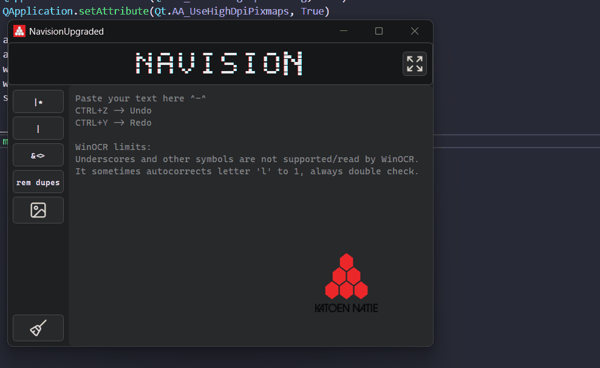

# NavisionUpgraded

A small Windows desktop utility tool for Business Central and Microsoft Dynamics NAV that can prepare lists of values for Navision filters. Paste or OCR a list of codes/words, join them with the filter separator you need, remove duplicates and do quick math on the side - all in one dark-themed window that ships as a single .exe

It's the modernized remake of The BETTER Navision:
(https://github.com/JonathanMovement/Navision_UtilityTool) 

New layout, built-in Windows OCR instead of Tesseract (nothing extra to install), a calculator panel, undo for every action, and an animated pixel-style title.



## Features
```
  Button  |   Description
----------------------------------------
 |*       | Joins every value with | and puts * in front of each other
 |        | Joins every value with |
 &<>      | Joins every value with &<>
 RemDupes | Removes duplicate values, one value per line
 OCR      | Reads text from a screenshot in the clipboard
 Clear    | Empties the text area
 Expand   | Slides the window open to show the calculator
```

## Calculator
- Click the buttons or type on the keyboard (number row or numpad) while the calculator display is active.
- Enter = =, Esc = clear, Backspace = delete last character, * or x = multiply.
- The display is read-only, so results can be selected and copied (Ctrl+C) but not edited by hand.

## OCR limitations
OCR uses the text recognition built into Windows (Windows.Media.Ocr), in English and Dutch.

Always double-check OCR results before using them in Navision.
Underscores and most other symbols are not read.
1, l and I can be mixed up, especially in small fonts.
Values can occasionally be skipped, for example short repeated-letter strings.
The English OCR language must be installed in Windows. It comes with English Windows; installing it otherwise needs administrator rights.

## Running from source
```powershell
python -m venv .venv
.venv\Scripts\activate
pip install -r requirements.txt
python main.py
```

The `icons` folder (button icons, logo) is not part of the repository because it contains company images. Without it the app still runs; buttons just show no icons and there is no background logo.

## Building the .exe
Build from a clean virtual environment with only `requirements.txt` installed - the PyWinRT
PyInstaller hook bundles every installed `winrt-*` package, so extra packages make the `.exe` bigger.

```powershell
pyinstaller --onefile --windowed --name NavisionUpgraded --icon icons\KTNlogo.ico --add-data "icons;icons" main.py
```

The finished file is `dist\NavisionUpgraded.exe`. It needs no installation and no admin rights.